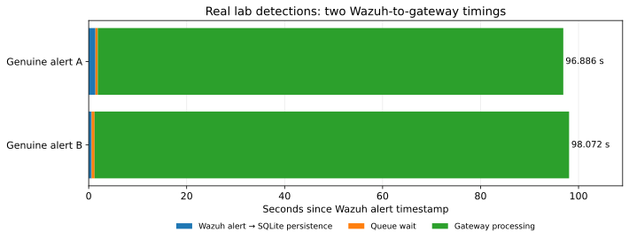
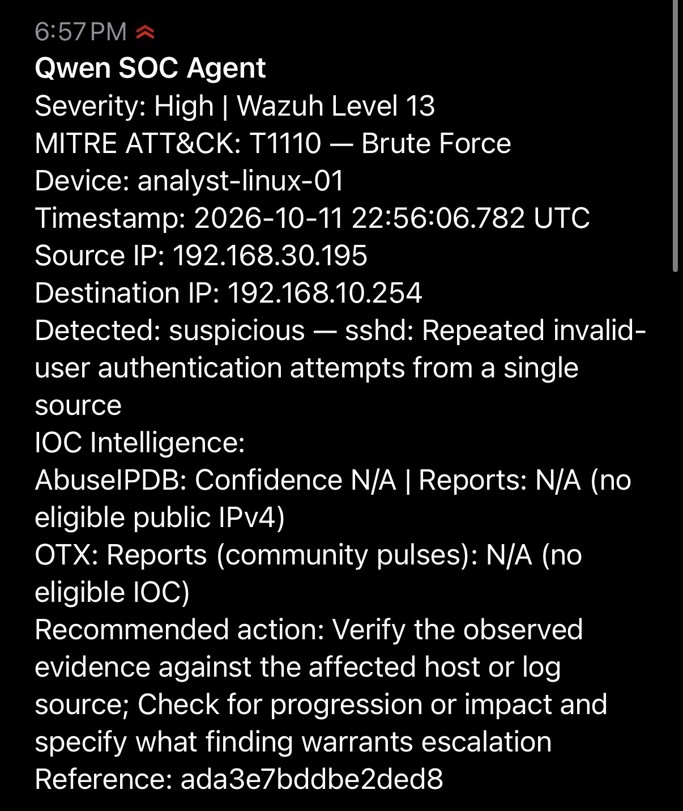

# Qwen3-0.6B on an 8 GB Raspberry Pi 5 | My Personal AI SOC Agent

**A low-cost, locally hosted AI assistant that helps me investigate Wazuh security alerts when I can't be at my SIEM.**

Between work, school, and everything else, I sometimes go two or three days without being able to sit down and properly review my homelab. I wanted a way to know when something needed my attention without having to constantly watch a dashboard.

So I set out to see what I could build with a Raspberry Pi 5, an 8 GB memory limit, a small open-weight language model, and the security tools I already have deployed in my homelab.

The result is a working AI-assisted security workflow. Wazuh detects an event, Qwen3-0.6B analyzes it locally, threat-intelligence services add context when eligible indicators are available, and I receive an actionable summary on my iPhone. The goal for any good security tool is to assist the analyst, not replace them. For me, that means being able to notice important security events and begin investigating even when I'm away from my SIEM dashboard. 

## Project at a Glance

<table align="center">
  <tr>
    <td><strong>Hardware</strong></td>
    <td>Raspberry Pi 5 (8 GB)</td>
  </tr>
  <tr>
    <td><strong>Local AI</strong></td>
    <td>Qwen3-0.6B, CPU inference</td>
  </tr>
  <tr>
    <td><strong>Detection / SIEM</strong></td>
    <td>Wazuh + Linux agents + UniFi telemetry</td>
  </tr>
  <tr>
    <td><strong>Threat intelligence</strong></td>
    <td>AbuseIPDB, AlienVault OTX, IPsum</td>
  </tr>
  <tr>
    <td><strong>Notifications</strong></td>
    <td>ntfy → iPhone</td>
  </tr>
  <tr>
    <td><strong>Deployment</strong></td>
    <td>Hardened Docker gateway + separate systemd publisher</td>
  </tr>
  <tr>
    <td><strong>Burst protection</strong></td>
    <td>Durable SQLite queue, one Qwen worker, authenticated SSH handoff</td>
  </tr>
  <tr>
    <td><strong>Response philosophy</strong></td>
    <td>Human-in-the-loop; no automatic blocking</td>
  </tr>
</table>

### What I Actually Accomplished

- **Connected Wazuh to local AI inference** using a custom integration and structured event normalization.
- **Developed the threat-intelligence workflow** for eligible public IPs and file hashes, with provider-specific results rather than unverified AI claims.
- **Built stateful mobile alert delivery** with audit checkpoints, deduplication, retry handling, and a compact overview of the event.
- **Hardened the deployment** with non-root execution, a read-only container filesystem, reduced capabilities, restricted network access, and rollback procedures.
- **Tested the entire pipeline**, including an actual Wazuh file-integrity event whose SHA-256 reached the gateway, OTX lookup, and my phone.
- **Experimented with CPU-only LoRA training**, evaluated it against the base model, and deliberately kept the original model when the adapter didn't show an improvement.
- **Added a durable alert queue** between Wazuh and the Pi model to accept short alert bursts, deduplicate events, and serialize inference instead of allowing multiple simultaneous jobs. [Queue design and evidence →](docs/durable-queue.md)

### Real Wazuh-to-Qwen Benchmark

I generated controlled failed SSH authentication activity from a separate security-testing VM against a disposable Linux endpoint. Wazuh detected and correlated the resulting authentication failures. Two genuine Wazuh-generated level-13 alerts then moved through my authenticated SSH handoff, durable SQLite queue, Raspberry Pi Qwen3-0.6B gateway, and ntfy workflow. 

  

<table align="center">
  <thead>
    <tr>
      <th>Result</th>
      <th align="right">Measured value</th>
    </tr>
  </thead>
  <tbody>
    <tr>
      <td>Genuine correlated alerts / delivered queue jobs</td>
      <td align="right">2 / 2</td>
    </tr>
    <tr>
      <td>Mean Wazuh alert → gateway completion</td>
      <td align="right">97.48 s</td>
    </tr>
    <tr>
      <td>Mean Wazuh → SQLite persistence</td>
      <td align="right">0.99 s</td>
    </tr>
    <tr>
      <td>Mean queue wait</td>
      <td align="right">0.54 s</td>
    </tr>
    <tr>
      <td>Mean Qwen generation</td>
      <td align="right">95.93 s</td>
    </tr>
  </tbody>
</table>

   

  

 

## How the SOC Agent Works

**Linux agents / UniFi > Wazuh detection (level 13+) > custom integration > restricted SSH tunnel > durable SQLite queue > local Qwen gateway > audit > ntfy publisher / eligible threat intelligence > iPhone > my investigation**

The flow above describes the model-and-notification stages. The queue handles alert admission and processes events one at a time.

[View the queue architecture →](docs/durable-queue.md)

The important distinction is that Wazuh detects the event. Qwen doesn't replace the SIEM. The model receives selected, normalized event details, explains what they may indicate, and suggests where I should investigate next.

Threat intelligence adds independent context where a supported indicator is available. AbuseIPDB reports a confidence score and report count for eligible public IPs; AlienVault OTX reports community-pulse associations for supported IOCs. Neither result automatically proves maliciousness.

[See the full stage-by-stage architecture →](docs/architecture.md)

## Why I Wanted to Build This

One problem I face with my homelab is that sometimes I simply don't have the time to sit down and monitor everything. A few days can go by before I get a chance to dig through my alerts, and a lot can happen during that time.

That's not only a homelab issue. Small organizations may not have a dedicated security operations center watching events 24/7. Their security tools might collect useful alerts, but the hard part is finding the time and expertise to investigate them.

With AI becoming more accessible to both attackers and defenders, I wanted to try using it on the defensive side of that problem. And I wanted to do it locally, on inexpensive hardware, instead of depending on a large cloud-hosted language model for inference.

The goal was never to create an autonomous SOC analyst. I wanted an assistant that could help me understand what happened, compare relevant indicators with external intelligence, and give me a starting point when I finally picked up my phone or opened Wazuh.

## What My Phone Receives

Each notification presents the information I need for initial triage, so I can quickly assess an alert and decide where to investigate when I return to Wazuh.

### A Real Alert on My iPhone

  

*Real Wazuh generated SSH detection analyzed locally by Qwen and delivered through ntfy. External IOC enrichment was not applicable to the private source IP.*

- **Severity:** label and original Wazuh rule level
- **MITRE ATT&CK:** technique ID/name carried from the Wazuh rule; no AI guessing
- **Device:** the endpoint associated with the event
- **Timestamp:** the original Wazuh event time in UTC, not the phone delivery time
- **Source IP / Destination IP:** structured addresses supplied by Wazuh, or `N/A` when missing
- **Detected:** a short explanation of what the model found
- **IOC Intelligence:** AbuseIPDB score/reports and OTX community-pulse counts where applicable
- **Recommended action:** practical investigation steps I can review myself

No firewall rules are changed by this workflow. Receiving an alert is the beginning of an investigation and not an automated decision to block a host or an IP address. I use [**NIST SP 800-61 Rev. 3**](https://nvlpubs.nist.gov/nistpubs/SpecialPublications/NIST.SP.800-61r3.pdf) as the investigation mindset for Qwen: validate the evidence, look for progression/impact, and identify an escalation condition.

## End-to-End Testing

I didn't want to stop at “the model returned an answer.” I tested whether actual Wazuh events made it through each part of the pipeline.

| Test | Verified result |
|---|---|
| **Controlled SSH detection** | Two genuine Wazuh level-13 correlated alerts passed through the queue and Qwen pipeline, with both notifications observed on my iPhone |
| **File-integrity monitoring** | Wazuh detected a harmless file-integrity canary. Its SHA-256 was preserved through the gateway and OTX lookup |
| **Threat-intelligence handling** | Controlled public-IP and file-hash lookups produced provider-specific evidence without treating a lack of reports as a clean verdict |
| **Audit and event integrity** | Structured Qwen output, native Wazuh MITRE metadata, event timestamps, and source/destination IP fields were verified |
| **Queue resilience** | A ten-event isolated mock-gateway burst test passed. The two genuine detections completed through the deployed single-worker queue |

## What I Learned Building It

The biggest surprise was how much work sat *around* the model. Getting Qwen to generate text was only one piece. I had to understand Wazuh alert structures, decide which fields were reliable, carry indicators through each component, keep the Raspberry Pi secure, handle notification state, and verify that the phone actually received the right information.

I also learned that successfully fine-tuning a model doesn't mean you've made it better. I completed a small CPU-only LoRA experiment on the Pi, but held-out tests didn't show an improvement over the original model. I kept the production model unchanged rather than promote an unproven adapter.

That was an important part of the project for me: the system should be useful because it is testable and understandable, not because an AI model says it's confident.

[Read the challenges and lessons learned →](docs/lessons-learned.md)

**My Final Takeaway:** AI doesn't need to replace an analyst to be useful. If it can help me notice a security event sooner, understand the evidence, and know where to start investigating, that's already valuable and can help me better defend my network.

## Project Documentation

| Document | What it covers |
|---|---|
| [Architecture](docs/architecture.md) | End-to-end data flow and where each service runs |
| [Implementation](docs/implementation.md) | What was built and how the integrations fit together |
| [Durable Queue](docs/durable-queue.md) | Durable SQLite buffering, authenticated SSH handoff, single-worker inference, and recovery behavior |
| [Measured Wazuh-to-Qwen Benchmarks](docs/real-world-benchmarks.md) | Two genuine correlated SSH detections, measured queue and inference times, and Pi telemetry |
| [Lessons Learned](docs/lessons-learned.md) | Raspberry Pi constraints, AI limitations, and engineering takeaways |
