# Architecture: From a Wazuh Alert to My iPhone

This is the full processing path behind the short diagram in the [main README](../README.md). The Qwen model runs locally on the Raspberry Pi 5. Threat-intelligence lookups and notification delivery are handled by separate services.

## The Flow, Step by Step

| Stage | Component | What happens |
|---|---|---|
| 1. Telemetry | Linux endpoints / UniFi | Hosts and network devices generate security-relevant events. |
| 2. Ingestion | Wazuh manager | Wazuh decodes events and evaluates detection rules. |
| 3. Detection | Wazuh manager | A matching rule supplies severity, rule ID, event time, and MITRE ATT&CK metadata when available. |
| 4. Admission filtering | Wazuh integration | Only alerts matching the configured integration filters qualify for forwarding. |
| 5. Secure handoff | Wazuh manager / SSH tunnel | Eligible alerts are forwarded to the Raspberry Pi's loopback-only queue endpoint. |
| 6. Durable acceptance | Pi SQLite queue | The queue validates requests, checks duplicate identifiers, and persists accepted events. |
| 7. Worker dispatch | Pi queue worker | A single worker submits eligible queued events to the local Qwen gateway. |
| 8. Normalization | Pi gateway | Structured event fields, original timestamps, IP addresses, and native Wazuh MITRE metadata are preserved. |
| 9. Local inference | Qwen3-0.6B | The model produces an assessment and evidence-first investigation suggestions. |
| 10. Persistent audit | Gateway | A JSONL audit records the event, model output, and processing status. |
| 11. Publisher intake | systemd publisher | The publisher reads valid audit records using its persistent cursor. |
| 12. Duplicate handling | Publisher | Previously handled notifications are skipped using saved identifiers. |
| 13. IOC selection | Publisher | Eligible structured indicators are selected for enrichment. |
| 14. Threat intelligence | IPsum / AbuseIPDB / OTX | Supported indicators receive provider-specific context when applicable. |
| 15. Notification formatting | Publisher | The notification combines Wazuh fields, Qwen analysis, threat intelligence, and recommended actions. |
| 16. Delivery | ntfy / iPhone | The alert is published and delivered to the phone. |
| 17. Investigation | Human operator | I review the available evidence and decide whether further action is necessary. |

## Overview of the Live Components

```mermaid
flowchart LR
    E[Linux endpoints + UniFi] --> W[Wazuh detection rules]
    W --> F{Integration filter match?}
    F -->|No| R[Remain in Wazuh]
    F -->|Yes| S[Restricted SSH tunnel]
    S --> D[(Durable SQLite queue)]
    D -->|One worker| G[Restricted Pi gateway]
    G --> N[Structured event normalization]
    N --> Q[Qwen3-0.6B local inference]
    Q --> A[(Persistent JSONL audit)]
    A --> P[ntfy publisher + cursor/dedup]
    P --> I[Eligible IOC extraction]
    I --> AB[IPsum / AbuseIPDB for IPs]
    I --> O[AlienVault OTX]
    I -->|No eligible IOC| M
    N -->|Native Wazuh MITRE + event time + IP fields| A
    AB --> M[Provider evidence + Wazuh MITRE + formatting]
    O --> M
    M --> T[Authenticated ntfy publish]
    T --> PH[iPhone alert]
    PH --> H[Human review and response]
```

## Service and Trust Boundaries

- The Wazuh manager remains responsible for generating detections, original rule levels, ATT&CK metadata and event timestamps.
- The gateway is a non-root, read-only Docker application on the Pi with restricted access and a mounted persistent audit volume.
- The Qwen model performs local CPU inference. It does not make an API call to a cloud model to generate its assessment.
- The notification publisher is a separate non-root systemd service. It consumes the gateway audit and performs eligible reputation lookups.
- AbuseIPDB can provide a confidence score and reports for eligible public IPs. AlienVault OTX provides community-pulse associations; it does not supply an equivalent confidence score.
- The pipeline is advisory. It does not automatically change firewall rules, isolate systems, or delete files.

## Processing and Recovery Branches

1. Below the minimum level: Wazuh retains the event, but alerts at level 0–12 do not qualify for the Qwen integration.
2. Invalid inference or failed processing: Status is preserved in the audit, rather than represented as a trustworthy assessment.
3. No eligible IOC / provider unavailable: The report shows an unavailable or not-applicable result instead of pretending there is a clean verdict.
4. Already delivered: The publisher uses its saved cursor and recent IDs to avoid replaying ordinary audit records.
5. Delivery problem: A pending notification can be retried. Comprehensive crash/recovery guarantees have not yet been established.
6. Final handoff: The analyst confirms context and determines the next action.
