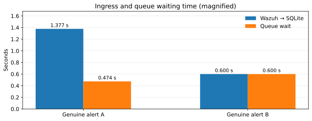
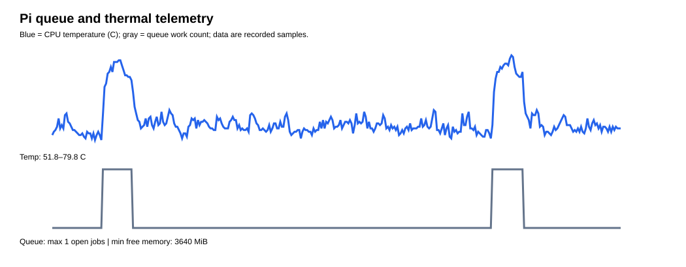

# Measuring the Real Wazuh-to-Qwen SOC Workflow

I wanted real detection evidence rather than timing a direct HTTP request to the model. I generated controlled unsuccessful SSH authentication activity from a ParrotOS VM against an enrolled, disposable Ubuntu Linux host. Wazuh identified the individual events, correlated repeated failures using an offline-validated, narrowly scoped local level-13 rule, and forwarded the genuine detections to my Raspberry Pi through a restricted SSH tunnel.

## The Measured Path

 

<table align="center">
  <thead>
    <tr>
      <th>Measurement</th>
      <th align="right">Run A</th>
      <th align="right">Run B</th>
      <th align="right">Mean / Result</th>
    </tr>
  </thead>
  <tbody>
    <tr>
      <td>Wazuh alert > queue persistence</td>
      <td align="right">1.377 s</td>
      <td align="right">0.600 s</td>
      <td align="right">0.989 s</td>
    </tr>
    <tr>
      <td>Queue wait before processing</td>
      <td align="right">0.474 s</td>
      <td align="right">0.600 s</td>
      <td align="right">0.537 s</td>
    </tr>
    <tr>
      <td>Gateway processing wall time</td>
      <td align="right">95.036 s</td>
      <td align="right">96.871 s</td>
      <td align="right">95.954 s</td>
    </tr>
    <tr>
      <td>Model generation time</td>
      <td align="right">95.0143 s</td>
      <td align="right">96.853 s</td>
      <td align="right">95.934 s</td>
    </tr>
    <tr>
      <td><strong>Wazuh alert → gateway completion</strong></td>
      <td align="right"><strong>96.886 s</strong></td>
      <td align="right"><strong>98.072 s</strong></td>
      <td align="right"><strong>97.479 s</strong></td>
    </tr>
    <tr>
      <td>SQLite final state</td>
      <td align="right">delivered</td>
      <td align="right">delivered</td>
      <td align="right">2/2</td>
    </tr>
    <tr>
      <td>iPhone delivery</td>
      <td align="right">observed</td>
      <td align="right">observed</td>
      <td align="right">confirmed, not timed</td>
    </tr>
  </tbody>
</table>

 

The first observed SSH sequence lasted from 22:35:07 to 22:35:41 UTC; the matching Wazuh level-13 alert timestamp was 22:35:34.630 UTC, or 27.63 seconds after activity began. That interval includes the human-paced authentication attempts needed to reach the correlation threshold. 

## Measured Performance Visuals

  

  

  

   

  

